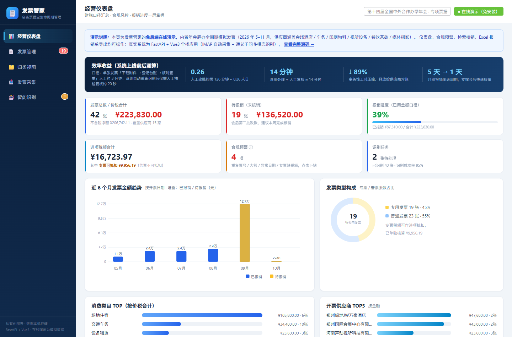
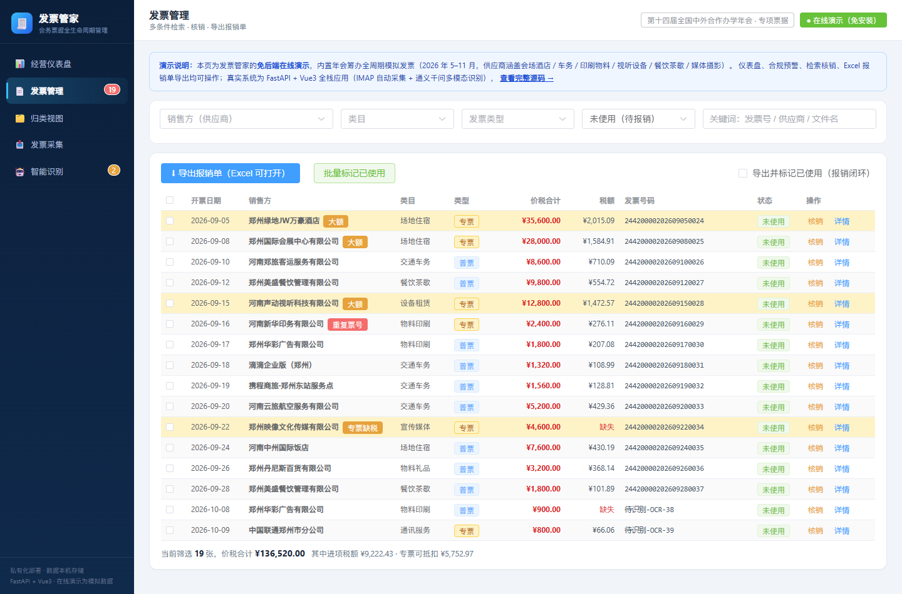
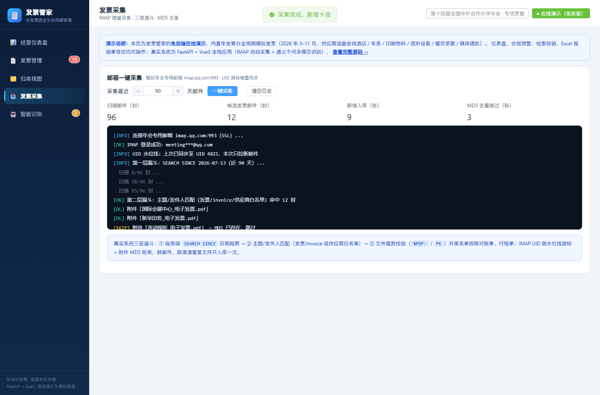
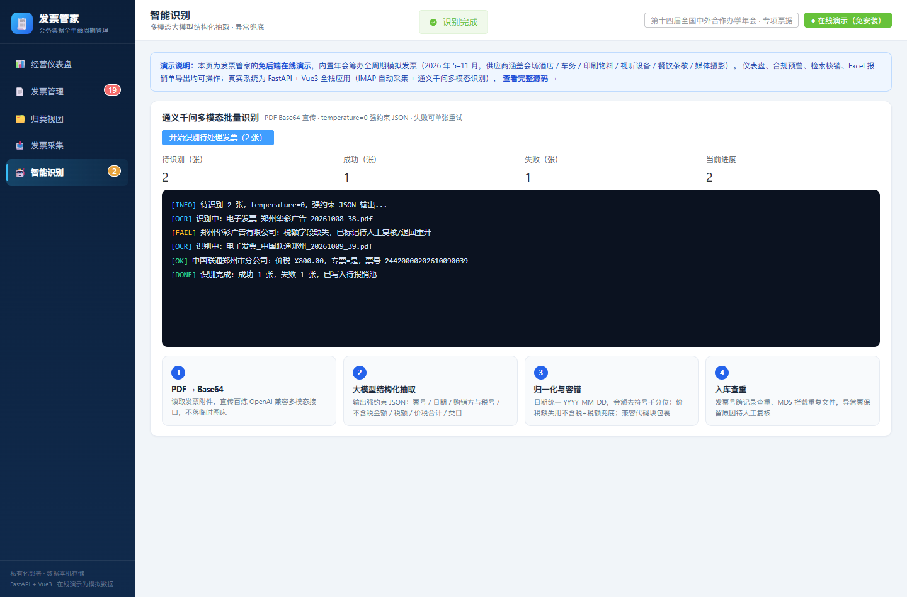

<div align="center">

# 发票管家 · Invoice Manager

**邮箱自动采集 → 大模型智能识别 → 合规预警 → 归类检索 → 报销闭环，一站式电子发票管理系统**

[](https://46bzvs7m64-gif.github.io/invoice-manager/)


> **[👉 点击体验在线演示（免安装）](https://46bzvs7m64-gif.github.io/invoice-manager/)** — 内置「第十四届全国中外合作办学年会」会务场景模拟数据（42 张发票 / 15 家供应商 / 2026 年 5–11 月全周期），完整体验经营仪表盘、四类合规预警下钻、检索核销、Excel 报销单导出、采集与识别演示全流程。

</div>

## 项目简介

发票管家是一个**私有化部署、单人使用**的电子发票全生命周期管理系统。它自动登录邮箱采集电子发票附件，通过三层漏斗过滤与去重保证数据干净，调用通义千问多模态大模型将发票 PDF 结构化为可检索的数据，并支持按开票对象归类、多条件组合检索、使用状态核销、财税口径仪表盘统计与 Excel 报销单导出。

数据全部保存在本机，不上传第三方服务器；一个 Python 进程同时承载后端 API 与前端页面，一台电脑、一条命令即可运行，也支持手机通过局域网访问。仓库根目录 `index.html` 为**免后端在线演示页**（Vue3 + Element Plus CDN 单文件），与真实系统同一套交互与财税口径。

## 业务场景：大型活动 / 会务票据管理

以一场全国性年会为例：筹办周期 5–6 个月，会场、酒店、车务、物料印刷、视听设备、餐饮茶歇、摄影媒体等 **10+ 家供应商、数十至上百张发票**，跨「预付定金—会中结算—会后核销」多批次到达财务邮箱，传统人工模式存在三个痛点：

| 痛点 | 人工模式 | 发票管家 |
|---|---|---|
| **建账慢** | 逐封邮件下载附件、手工登记台账，单张约 3 分钟 | IMAP 自动采集 + 大模型识别，人工仅需抽检复核约 20 秒/张 |
| **易出错** | 重复票号、未来日期票、专票缺税额靠肉眼，漏检即税务风险 | 规则引擎全量扫描四类风险，点击预警直接下钻定位发票 |
| **报销慢** | 会后翻聊天记录、对账单凑发票，月结出表约 5 个工作日 | 筛选即导出带合计行的报销单，可选「导出即核销」，约 1 个工作日出表 |

> 演示数据测算口径：42 张发票人工建账约 126 分钟（≈0.26 人日）→ 系统处理 + 人工复核约 14 分钟，事务性工时压缩约 89%。该场景同样适用于差旅报销、项目制采购、连锁门店费用归集等「票据多、供应商散、核销周期长」的管理场景。

## 产品截图（在线演示）

**经营仪表盘** — 六大财税 KPI、效率收益测算、6 个月堆叠趋势、专普票环形构成、类目 / 供应商 TOP、四类合规预警一屏掌握：



**发票管理** — 多条件组合筛选，异常票行内高亮标红（大额 / 重复票号 / 专票缺税），合计实时联动，支持勾选批量核销与报销单导出：



**发票采集** — IMAP UID 增量游标 + 三层漏斗 + MD5 去重，实时日志与四项漏斗计数：



**智能识别** — 通义千问多模态 `temperature=0` 强约束 JSON 抽取，成功 / 失败双路径，失败票标注原因可退回重开：



## 在线演示导览

打开 <https://46bzvs7m64-gif.github.io/invoice-manager/> 即可操作，建议体验路径：

1. **仪表盘**：查看价税合计 / 进项税额 / 专票可抵扣额 / 报销进度，点击「合规预警」卡片下钻
2. **预警下钻**：体验重复票号（供应商重发邮件）、大额（≥1 万）、未来日期（11 月预录票）、专票缺税额（需退回重开）四类异常的筛选定位与发票详情抽屉
3. **发票管理**：组合筛选 → 勾选 → 导出 CSV 报销单（BOM 编码，Excel 直接打开），勾选「导出并标记已使用」完成报销闭环
4. **归类视图**：按供应商 / 类目折叠分组，组级金额合计，用于与供应商集中对账
5. **发票采集 / 智能识别**：点击按钮观看三层漏斗采集日志与多模态识别逐张日志（模拟数据，无网络请求）

## 功能特性

- **邮箱配置** — QQ / 163 邮箱一键填充服务器参数，授权码 Fernet 对称加密存储，保存前可一键测试连接
- **一键采集** — 基于 IMAP UID 游标的增量同步，只拉取新邮件；服务端日期粗筛 → 主题/发件人匹配 → 文件魔数与黑名单校验的三层过滤；附件 MD5 哈希去重
- **手动上传** — 拖拽或点选上传本地 PDF / OFD 发票，支持批量多选；与邮箱采集同一套格式校验、魔数校验与 MD5 去重标准，适合从各类开票平台手动下载的发票
- **智能识别** — PDF 以 Base64 直传百炼 OpenAI 兼容接口（qwen3.8-flash / max），temperature=0 保证抽取确定性，强约束纯 JSON 输出；自动完成日期归一化（YYYY-MM-DD）、金额清洗（去货币符号与千分位）、发票号跨记录查重
- **批量识别** — 支持「待识别 / 识别失败 / 全部重识别」三种范围，实时进度条与逐张日志
- **异常兜底** — 识别失败保留错误原因，支持单张重试；OFD 格式暂不支持自动识别，可手动编辑录入，保存后视为识别成功
- **归类视图** — 按销售方 / 消费类目折叠分组，组级展示发票张数、已报张数、金额合计、日期跨度，点击展开组内明细
- **多条件检索** — 销售方、消费类目、发票类型、使用状态、关键词任意组合；实时显示当前筛选结果价税合计 / 进项税额 / 专票可抵扣额
- **核销管理** — 单张标记 / 撤销、勾选批量标记，自动记录报销批次；已使用发票默认从待报销结果中隐藏，可切换查看历史
- **经营仪表盘** — 财税口径的一页式经营看板：发票总数 / 价税合计、待报销金额、报销进度（已用金额占比 + 进度条）、进项税额与其中**专票可抵扣额**、合规预警数、识别任务数六大 KPI；顶部效率收益带量化系统价值；近 6 个月已报销 / 待报销堆叠趋势；发票类型环形构成、消费类目 TOP、开票供应商 TOP5 排行
- **合规与风控预警** — 规则引擎自动扫描四类风险并支持点击下钻到对应发票：① 重复发票号码 ② 大额发票（单张价税合计 ≥ 1 万元）③ 开票日期异常（晚于系统日期）④ 专用发票缺失税额（影响进项抵扣）；无异常时展示账票相符的通过态
- **深色侧边栏布局** — 五模块导航（发票管理 / 智能识别带待办角标），桌面端固定侧栏、移动端自动转顶部横滑；纯 CSS / SVG 图表，零图表库依赖，适配手机浏览器
- **报销单导出** — 在线演示导出带 BOM 的 CSV（Excel 直接打开、含合计行）；完整系统按当前筛选导出 .xlsx（表头加粗、列宽自适应），可选「导出并标记已使用」，一个动作完成报销闭环

## 产品文档（PRD）

项目按标准产品流程先行完成需求结构化，文档随版本库归档于 [`docs/product/`](docs/product/)：

1. [软件开发计划](docs/product/01-software-development-plan.md) — 阶段划分、各阶段交付物、完成标准与验收规则
2. [软件需求与规格说明](docs/product/02-software-requirements-spec.md) — 功能 / 非功能需求、业务规则、数据逻辑与技术选型依据
3. [用户交互设计规范](docs/product/03-interaction-design-spec.md) — 交互逻辑、操作流程、页面结构与体验原则

## 系统架构

前后端一体化单体应用，单进程承载 API 与静态资源，零外部中间件：

```
┌──────────────────────────────────────────────────────────┐
│  浏览器 / 手机浏览器                                       │
│  Vue 3 + Element Plus 单页应用（CDN 引入，免构建）          │
└───────────────┬──────────────────────────┬───────────────┘
                │ HTTP / RESTful            │ Multipart 上传
┌───────────────▼──────────────────────────▼───────────────┐
│  FastAPI（uvicorn，:8000）                                │
│  ┌────────────────────────────────────────────────────┐  │
│  │  Router 层：email / sync / ocr / groups / invoices │  │
│  │              dashboard                             │  │
│  ├────────────────────────────────────────────────────┤  │
│  │  Service 层：email_client / ocr_service / ocr_batch│  │
│  │              task_manager / crypto                 │  │
│  ├────────────────────────────────────────────────────┤  │
│  │  SQLAlchemy 2.0 ORM          后台线程任务池         │  │
│  └───────────────┬────────────────────────────────────┘  │
└──────────────────┼───────────────────────────────────────┘
                   │
        ┌──────────▼──────────┐
        │  SQLite（单文件）     │
        │  data/invoices.db   │
        └─────────────────────┘

  ┌──────────────┐         ┌─────────────────────────┐
  │ QQ / 163 IMAP│◄────────│ 采集服务（UID 增量游标）  │
  └──────────────┘         └─────────────────────────┘
                           ┌─────────────────────────┐
                           │ 百炼 DashScope API       │
                           │ qwen3.8 多模态识别       │◄── PDF Base64
                           └─────────────────────────┘
```

## 技术栈

| 层 | 技术选型 | 说明 |
|---|---|---|
| 后端框架 | FastAPI + Uvicorn | 异步 ASGI，自动 OpenAPI 文档（/docs） |
| 数据校验 | Pydantic v2 | 请求模型与参数校验 |
| ORM | SQLAlchemy 2.0 | 声明式模型，同步会话 |
| 数据库 | SQLite 3 | 单文件零运维，适合单人场景 |
| 前端 | Vue 3（全局构建） | Composition API，CDN 引入无构建链 |
| UI 组件库 | Element Plus | 表格 / 表单 / 抽屉 / 消息提示 |
| 邮件协议 | imaplib（标准库） | IMAP4 SSL，支持 163 邮箱 ID 命令 |
| 大模型 | 通义千问 qwen3.8（百炼平台） | OpenAI 兼容接口，多模态 PDF 理解 |
| 加密 | cryptography（Fernet） | 邮箱授权码对称加密存储 |
| Excel | openpyxl | 内存流式生成 .xlsx 报销单 |

## 快速开始

### 环境要求

- Python 3.10 及以上（安装时勾选 **Add Python to PATH**）
- Windows / macOS / Linux 均可（本文以 Windows PowerShell 为例）

### 安装与启动

```powershell
cd invoice-manager/backend
pip install -r requirements.txt
python run.py
```

启动成功后：

- 本机浏览器打开：<http://127.0.0.1:8000>
- 交互式 API 文档：<http://127.0.0.1:8000/docs>
- 手机访问（需与电脑连同一 WiFi）：`http://<电脑局域网IP>:8000`
  - 查看局域网 IP：Windows 执行 `ipconfig`，取 IPv4 地址（如 192.168.1.100）

> 只想快速看效果：直接打开在线演示 <https://46bzvs7m64-gif.github.io/invoice-manager/>，或用浏览器打开仓库根目录的 `index.html`，无需 Python 环境。

### 停止服务

在运行窗口按 `Ctrl + C`，或直接关闭终端窗口。

## 环境配置

首次运行前，将配置模板复制为 `.env`：

```powershell
Copy-Item .env.example .env
```

`.env` 主要配置项：

| 变量 | 必填 | 默认值 | 说明 |
|---|---|---|---|
| `QWEN_API_KEY` | 是 | 空 | 百炼 API Key，[在此获取](https://bailian.console.aliyun.com) |
| `QWEN_MODEL` | 否 | `qwen3.8-flash` | 识别模型，可改 `qwen3.8-max` 获得更高精度 |
| `QWEN_BASE_URL` | 否 | 百炼华北2地址 | OpenAI 兼容接口地址 |
| `ENCRYPTION_KEY` | 否 | 自动生成 | 授权码加密密钥，首次启动自动追加，无需手填 |
| `DEFAULT_SYNC_DAYS` | 否 | `90` | 默认采集最近天数 |
| `DATABASE_URL` | 否 | 本地 SQLite | 数据库连接串 |
| `STORAGE_PATH` | 否 | `invoices_files` | 发票附件存储目录 |
| `HOST` / `PORT` | 否 | `0.0.0.0` / `8000` | 服务监听地址与端口 |

> 修改 `.env` 后必须重启服务，配置仅在启动时加载。

## 使用流程

1. **配置 API Key**：编辑 `backend/.env`，将百炼 API Key 填到 `QWEN_API_KEY=` 后，重启服务
2. **配置邮箱**：「邮箱配置」页点快速填充 → 输入邮箱地址与 16 位授权码 → 测试连接 → 保存
3. **采集发票**：「发票采集」页设置天数 → 点「一键采集」查看实时日志；本地已有发票可在同页「手动上传发票」区拖拽上传（PDF / OFD，支持多选）
4. **智能识别**：「智能识别」页选择范围（默认「待识别」）→ 点「开始识别」，失败票按日志原因处理或单张重试
5. **查看经营仪表盘**：「经营仪表盘」页掌握价税合计 / 进项税 / 专票可抵扣 / 报销进度，查看趋势、类型与类目构成、供应商排行；点击合规预警卡片直接跳转列表定位
6. **归类浏览**：「归类视图」页按供应商 / 类目查看分组，点击展开组内发票，与供应商集中对账
7. **检索与核销**：「发票管理」页多条件检索；确认使用后点「核销」或勾选后「批量标记已使用」；点「导出报销单」导出（可选同时标记已使用，完成报销闭环）

## 项目结构

```
invoice-manager/
├── README.md                          # 项目说明（本文件）
├── index.html                         # 免后端在线演示页（GitHub Pages，Vue3 CDN 单文件）
├── docs/
│   ├── demo-*.png                     # 在线演示产品截图
│   └── product/                       # 产品文档（开发计划 / 需求规格 / 交互规范）
└── backend/
    ├── requirements.txt               # Python 依赖清单
    ├── .env.example                   # 环境配置模板
    ├── run.py                         # 启动入口（uvicorn）
    ├── app/
    │   ├── main.py                    # FastAPI 应用入口、路由注册、静态资源挂载
    │   ├── config.py                  # 配置加载（.env）与加密密钥自动生成
    │   ├── database.py                # 引擎与会话（SQLAlchemy）
    │   ├── models.py                  # 数据模型：邮箱账户 / 发票 / 同步日志
    │   ├── schemas.py                 # Pydantic 请求模型
    │   ├── routers/
    │   │   ├── email_router.py        # 邮箱配置 CRUD / 连接测试
    │   │   ├── sync_router.py         # 采集任务启动 / 状态轮询 / 日志
    │   │   ├── ocr_router.py          # 识别任务启动 / 状态 / 单张重试
    │   │   ├── groups_router.py       # 销售方 / 类目分组、筛选选项
    │   │   ├── dashboard_router.py    # 仪表盘统计与合规规则引擎
    │   │   └── invoice_router.py      # 列表 / 上传 / 编辑 / 标记 / 导出
    │   ├── services/
    │   │   ├── email_client.py        # IMAP 采集核心（增量、过滤、去重）
    │   │   ├── ocr_service.py         # 大模型调用、JSON 解析、字段归一化
    │   │   ├── ocr_batch.py           # 批量识别任务
    │   │   ├── task_manager.py        # 后台任务进度与日志管理
    │   │   └── crypto.py              # Fernet 授权码加解密
    │   └── static/
    │       └── index.html             # 完整系统前端单页（Vue3 + Element Plus CDN）
    ├── data/                          # 运行期生成：SQLite 数据库（不入版本库）
    └── invoices_files/                # 运行期生成：发票附件（不入版本库）
```

## API 概览

服务启动后可在 <http://127.0.0.1:8000/docs> 查看完整的交互式接口文档。

| 模块 | 方法 | 路径 | 功能 |
|---|---|---|---|
| 邮箱 | GET / POST / DELETE | `/api/email`、`/api/email/{id}` | 邮箱账户管理 |
| 邮箱 | POST | `/api/email/test` | 测试 IMAP 连接 |
| 采集 | POST | `/api/sync/start` | 启动后台采集任务 |
| 采集 | GET | `/api/sync/status/{task_id}` | 轮询任务进度 |
| 采集 | GET | `/api/sync/logs` | 历史采集记录 |
| 识别 | POST | `/api/ocr/start` | 启动批量识别（scope：pending/failed/all） |
| 识别 | GET | `/api/ocr/status/{task_id}` | 轮询识别进度 |
| 识别 | POST | `/api/ocr/retry/{invoice_id}` | 单张重试 |
| 分组 | GET | `/api/groups/sellers`、`/api/groups/buyers` | 按销售方 / 购买方分组 |
| 分组 | GET | `/api/groups/options` | 筛选器下拉数据 |
| 发票 | GET | `/api/invoices` | 多条件筛选 / 排序 / 分页列表 |
| 发票 | POST | `/api/invoices/upload` | 手动上传发票 |
| 发票 | GET | `/api/invoices/export` | 导出 Excel 报销单（mark_used=1 同时核销） |
| 发票 | GET / PUT / DELETE | `/api/invoices/{id}` | 详情 / 编辑 / 删除 |
| 发票 | GET | `/api/invoices/{id}/file`、`/preview` | 下载 / 在线预览 |
| 发票 | POST | `/api/invoices/{id}/use`、`/unuse`、`/batch-use` | 标记使用 / 撤销 / 批量标记 |
| 仪表盘 | GET | `/api/dashboard` | 财税汇总（净额/进项税/专票可抵扣/报销进度）、6 月趋势、类型与类目分布、TOP5、四类合规预警明细 |

## 核心设计

**增量同步双保险**：以邮箱账户的 IMAP UID 为水位线游标，已处理邮件不再拉取；附件内容计算 MD5 哈希，跨邮件、跨上传渠道的重复文件只入库一次。

**三层漏斗过滤**：服务端 `SEARCH SINCE` 日期粗剪 → 主题关键词（发票 / invoice）或发件人白名单判定候选 → 文件级校验扩展名、PDF 魔数（`%PDF-`）/ OFD 的 ZIP 头（`PK`），并用黑名单排除结账单、对账单、行程单等干扰附件。

**大模型抽取容错**：对返回内容兼容 ```json 代码块包裹与杂散文字；字段层做日期归一、金额去符号去千分位；价税合计缺失时以「不含税金额 + 税额」兜底；发票号码跨记录查重。

**后台任务模型**：采集与识别均以守护线程运行，内存任务管理器维护进度、计数与行日志，前端定时轮询渲染，无需消息队列与 WebSocket。

**敏感信息保护**：邮箱授权码使用 Fernet 对称加密后落库，加密密钥首次启动自动生成；API Key 仅保存在服务端 `.env`，前端不接触；`.env`、数据库与发票文件均被 `.gitignore` 排除。

## 仪表盘财税口径与合规规则

仪表盘所有指标由 `GET /api/dashboard` 一次聚合返回，前端不做二次推算：

**财税口径**

| 指标 | 口径 |
|---|---|
| 价税合计 `total_amount` | 全部发票 `amount_total` 之和 |
| 不含税净额 `net_total` | `amount_without_tax` 之和 |
| 进项税额 `tax_total` | `tax_amount` 之和；缺失时以 `价税合计 − 不含税金额` 兜底 |
| 专票可抵扣 `deductible_tax` | 仅统计**专用发票**的进项税额（普通发票不可抵扣） |
| 待报销 `unused_amount` | 状态为未使用（`unused`）发票的价税合计 |
| 报销进度 `used_ratio` | 已使用价税合计 ÷ 全部价税合计 × 100% |

专用发票判定：发票类型文本包含「专用」或「专票」即视为专票（兼容"增值税专用发票""电子专用发票"等写法）。

**合规预警四类规则**

| 规则 | 判定逻辑 | 业务含义 |
|---|---|---|
| 重复发票号码 `duplicates` | 同一发票号码出现 ≥ 2 次 | 疑似重复报销 / 重复入账 |
| 大额发票 `big_invoices` | 单张价税合计 ≥ 10,000 元（`BIG_AMOUNT`） | 大额支出重点复核合同与付款 |
| 开票日期异常 `future_invoices` | 开票日期晚于系统当天，或日期无法解析 | 录入错误 / 假票风险 |
| 专票缺税额 `missing_tax` | 专用发票税额为空或 ≤ 0 | 进项税无法抵扣，需退回重开 |

异常明细每类最多返回 10 条（`DETAIL_LIMIT`），总数由 `anomaly_count` 给出；前端点击任意预警卡片即带异常类型跳转「发票管理」列表定位处理。

**分布与趋势**：`monthly` 按开票日期聚合近 6 个月，每月返回张数、金额及已用 / 未用 / 税额拆分；`type_dist` 按发票类型、`category_dist` 按消费类目 TOP8 分别统计张数与金额；`top_sellers` 为开票对象价税合计 TOP5。

## 邮箱授权码获取

**QQ 邮箱**

1. 登录网页版 → 设置 → 账号
2. 找到「POP3/IMAP/SMTP 服务」，开启「IMAP/SMTP 服务」
3. 按提示发送短信验证，获得 **16 位授权码**

**163 邮箱**

1. 登录网页版 → 设置 → POP3/SMTP/IMAP
2. 开启「IMAP/SMTP 服务」
3. 在授权码窗口点「新增授权密码」，获得授权码

> 授权码不是邮箱登录密码；程序已内置 163 邮箱所需的 IMAP ID 命令。

## 常见问题

- **在线演示的数据会上传吗**：不会。演示页为纯前端模拟数据，所有计算、筛选、导出均在浏览器本地完成，无后端请求
- **登录失败 / 授权码错误**：确认使用 16 位授权码而非登录密码，并确认邮箱已开启 IMAP 服务
- **163 邮箱报 Unsafe Login**：程序会自动发送 IMAP ID 命令；仍失败请重启程序重试
- **手机无法访问**：确认手机与电脑在同一 WiFi，检查电脑防火墙是否放行 8000 端口
- **重复采集会重复入库吗**：不会，UID 游标跳过已处理邮件，MD5 哈希拦截重复文件
- **OFD 发票怎么办**：暂不支持自动识别，在「发票列表」点「编辑」手动录入字段即可
- **CSV 用 Excel 打开乱码**：演示导出已带 UTF-8 BOM，如仍异常请用「数据 → 从文本/CSV」以 UTF-8 编码导入

## 后续可选扩展

- [ ] 定时自动采集（守护任务每日检查新发票）
- [ ] 云服务器部署，支持外网访问
- [ ] iOS App（Capacitor 打包）/ 微信小程序
- [ ] 邮件正文链接型发票的自动开具与下载
- [ ] 发票真伪查验（对接税务平台接口）
- [ ] 多账套 / 多项目维度归集（会务号、部门、成本中心标签）
